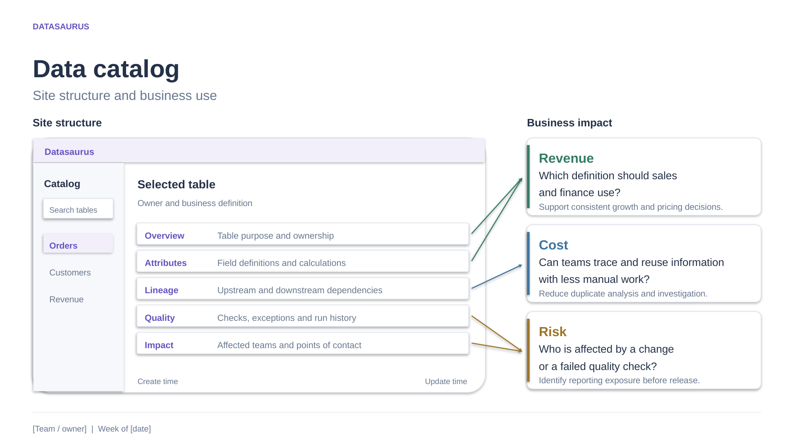
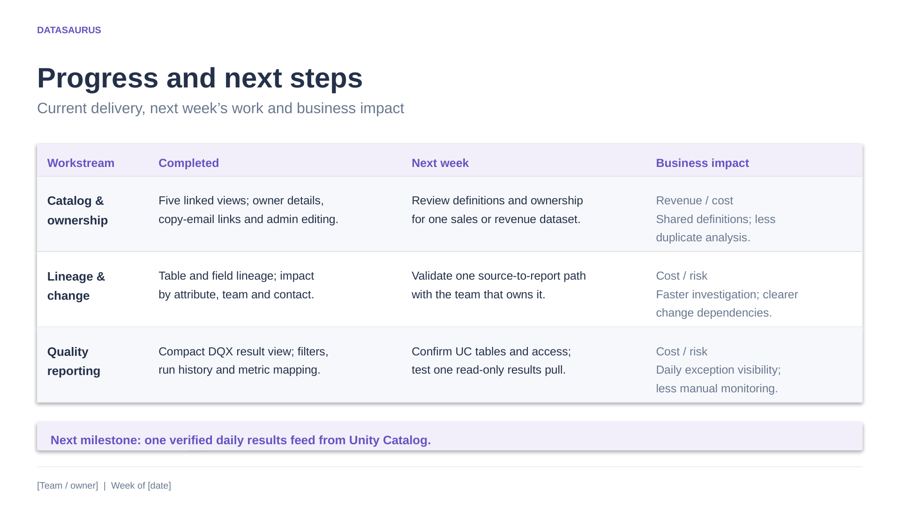

# Datasaurus management report

Open `datasaurus-report.pptx` for the editable English report or
`datasaurus-report.pdf` for the rendered version.

- [Editable PowerPoint](datasaurus-report.pptx)
- [PDF](datasaurus-report.pdf)
- [Reproduction prompt](reproduction-prompt.txt)
- [Build script](build_report.py)

- Page 1: website outline with all five views and connections to revenue, cost
  and risk questions. It absorbs the former page-by-page attachment.
- Page 2: completed work, next week's work and business impact by workstream.
  Keep it separate so it can be updated each week without redrawing the site.

Speaker notes carry the longer explanations and verification boundaries. Business
benefits are uses to validate; no financial uplift, savings or incident reduction
has been measured. Next-week work is a plan, not an implemented daily job.

Replace the team and reporting-week placeholders before presenting. All shapes,
arrows and text are native PowerPoint objects. `slide-1.png` and `slide-2.png` are
rendered screenshots of the actual deck. To rebuild, install `python-pptx` and run
`python build_report.py`, then export with PowerPoint or LibreOffice.

